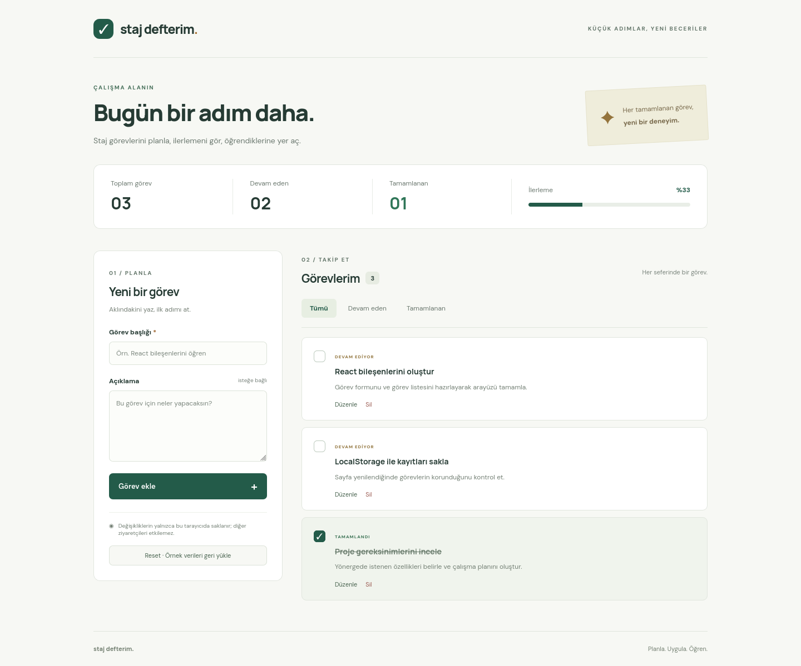
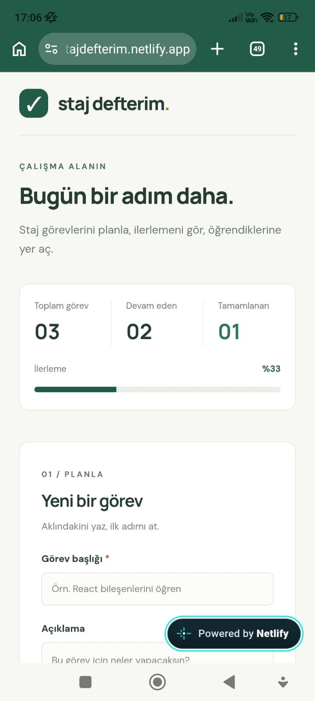
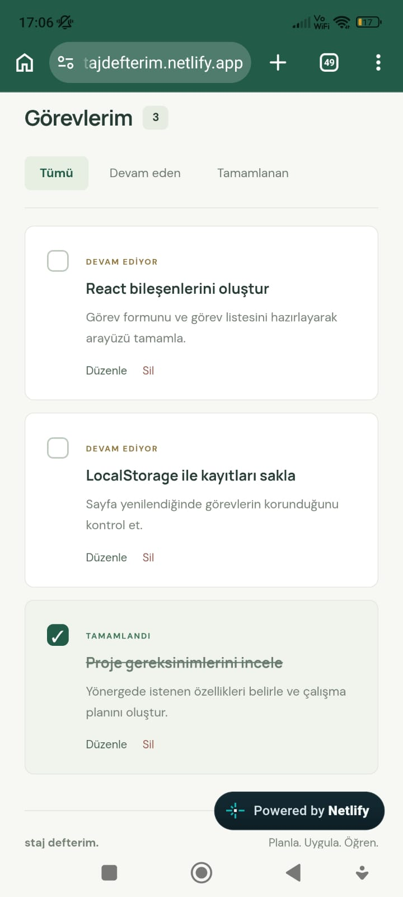

# Staj Defterim

Staj görevlerini planlamak ve ilerlemeyi takip etmek için React ile geliştirilmiş görev takip uygulaması.

**[Canlı siteyi aç → stajdefterim.netlify.app](https://stajdefterim.netlify.app/)**



## Özellikler

- Görev ekleme, listeleme, düzenleme ve onaylı silme
- Görevleri tamamlama ve duruma göre filtreleme
- Toplam görev, devam eden görev ve tamamlanma oranını görüntüleme
- Denenebilir örnek görevler ve başlangıç verilerine döndüren Reset butonu
- Tarayıcıda kalıcı kayıt ve mobil uyumlu tasarım

Değişiklikler yalnızca kullanılan tarayıcıda saklanır ve diğer ziyaretçileri etkilemez. Aynı tarayıcı profilinde kayıtlar korunur. Reset işlemi onaylandığında kişisel değişiklikler kaldırılıp örnek görevler geri yüklenir.

## Kurulum

Node.js 24 ve npm ile:

```bash
npm ci
npm run dev
```

Terminalde gösterilen yerel adresi tarayıcıda açın.

## Mobil görünüm

<p>
  
  
</p>

## Kullanılan teknolojiler

React · Vite · JavaScript · CSS · LocalStorage

## Derleme ve test

```bash
npm run build
npm run preview
```

Tarayıcı testlerini çalıştırmak için:

```bash
npx playwright install firefox
npm test
```

Testler görev işlemlerini, kayıtların korunmasını, Reset işlemini, ziyaretçi bağımsızlığını, depolama hatalarını ve mobil görünümü kontrol eder.
